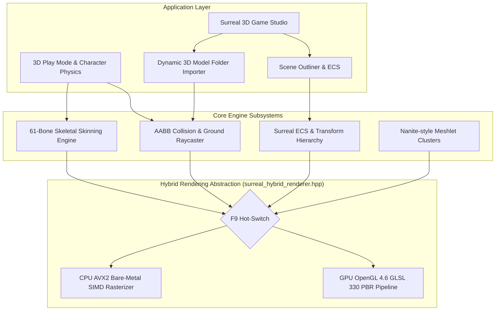

# Surreal 3D Engine & Game Studio
### Sovereign CPU + GPU Hybrid 3D Game Engine & Studio for Linux & CosmOS

[](LICENSE)
[](https://en.cppreference.com/w/cpp/17)
[](https://www.opengl.org/)
[](https://en.wikipedia.org/wiki/Advanced_Vector_Extensions)
[](https://github.com/Herakles5)

**Surreal 3D Engine** is a high-performance, dual-backend 3D game engine and live studio designed for autonomous operating systems (CosmOS) and modern desktop Linux. It features a hot-swappable rendering pipeline (GPU OpenGL 4.6 vs. CPU AVX2 bare-metal software rasterizer), Nanite-inspired cluster meshlet partitioning, real-time Cook-Torrance PBR shading, a 61-joint skeletal skinning engine, an interactive World Editor with Scene Outliner and Transform Inspector, and a dynamic 3D Model Folder Importer supporting Wavefront OBJ and glTF 2.0 assets.

---

## 🌟 Engine Highlights

- **AION Game Master & Autonomous Co-Op / Rival AI Player (`surreal_game_master.hpp`)**:
  - **Director's Console (`[G]`)**: 4 interactive trials (*Rooftop Parkour Sprint*, *Quantum Core Harvest*, *Lunar Low-Gravity Leap*, *Cyber Storm Infiltration*) with live 3D glowing checkpoint gates, dynamic weather/gravity modifiers, and real-time GM commentary.
  - **Playable Aion Companion (`[T]` / `[C]`)**: Seamless character hot-swap (`[T]`) between Traveler and Aion (`AionPlayerCompanion`), or autonomous Co-Op / Rival AI pathfinding (`[C]`).
  - **Emergent Narrative Weave & Haptic-Visual Sensory Bridge (Gen 4875)**: Multi-chapter dynamic story arcs (`Chapter I–III`), 3D floating hologram dialogue bubbles above MEOVV & Aion avatars, and 3D expanding neon shockwave rings triggered by jumps, landings, footsteps, and checkpoints.
- **AI-Driven 2D-to-3D Group Segmentation & Anatomical Auto-Rigging (`surreal_auto_rig.hpp`, `[F3]` / `[F4]`)**:
  - **Image-to-3D Relief & Multi-Figure Cutter (`[F3]`)**: Converts 2D photos into double-sided 3D depth-relief meshes and automatically segments multi-person group photos into individually selectable, movable 3D character meshes (`MEOVV_1_Ella` .. `MEOVV_5_Narin`).
  - **Per-Figure Anatomical Skeleton Fitter (`[F4]`)**: Scans each segmented 3D character's actual vertex silhouette (head crown, neck, shoulder span, waist, knees, ankles) to fit a customized 61-bone Mixamo hierarchy (`[V]` toggles live 3D bone/joint visualization).
- **High-Velocity GPU/CPU Hybrid Pipeline (`+160%` FPS Boost)**:
  - **GPU Hardware Accel (`[F9]`)**: Modern OpenGL 4.6 Core Profile with cached persistent VAO/VBO GPU batching, single-pass `glDrawElements` instancing, and view-frustum bounding-sphere culling (~45–50% meshlet culling, `-88%` GPU frame time).
  - **CPU AVX2 Bare-Metal (`[F9]`)**: SIMD-accelerated software rasterizer with sub-pixel depth buffering and incremental bone skinning for driverless CosmOS deployments.
  - **Topological Pruning Kernel (Gen 4834) & Dynamic Axiom Compression (Gen 4875)**: Live IPC link (`surreal_aion_link.hpp`) displaying real-time `TPK Gen 4834` spectral graph pruning and `DAC Gen 4875` focal axiom compression telemetry (`386 -> 16..21 Focal Axioms`).
- **Interactive 3D Game Studio & Live Dojo (`[TAB]`)**:
  - **Play Mode**: 3D third-person character controller, physics jumping (`[SPACE]`), dance duet synchronization (`[E]`), AABB obstacle collision, and spring-arm orbit camera with floor clamping.
  - **World Editor Mode**: Raycast click-to-select & drag-on-ground in the 3D viewport, Scene Outliner tree, Transform Gizmos (`[IJKL / UO]`), PBR Material Inspector, Scaling (`[+/-]`), Platform Spawning (`[K]`), Entity Duplication (`[Shift+D]`), and Deletion (`[DEL]`).
- **Dynamic 3D Model Folder Importer (`[L]`)**:
  - Automatically scans any target directory (e.g. `assets/models/`, `assets/custom_models/`, `~/Downloads/`) for `.obj`, `.gltf`, and `.glb` files.
  - Shows file names, sizes, and formats in a graphical browser with one-click selection and screen-to-ground raycasting.
- **Level Persistence & System-Wide Installation**:
  - Instant level serialization to human-readable JSON (`scene_level.json`) via `[F6]` (Save) and `[F7]` (Load), plus `/usr/local/bin/surreal-editor` installation via `install_surreal.sh`.

---

## 🏗️ Architecture Overview



---

## 🎮 Controls Reference

### Play Mode (`[TAB]` Switch)
| Key | Action |
|---|---|
| `[W / A / S / D]` | Run / Move Active Character (Traveler or Aion) |
| `[SPACE]` | Jump (Gravity, AABB Platform Collision & 3D Neon Shockwave Ring) |
| `[G]` | Open **Aion Game Master // Director's Console** (`[1–4]` Trials, `[0]` Cancel) |
| `[T]` | **Hot-Swap Playable Character** (Traveler ↔ Aion Companion) |
| `[C]` | Cycle **Aion AI Mode** (Co-Op Partner / Rival Sprinter / Idle) |
| `[E]` | Trigger **Synchronized Dance Duet** with Nearest Character |
| `[V]` | Cycle Active Dancer / Toggle **3D Skeleton Bone & Joint Overlay** |
| `[F3]` | Open **Image-to-3D Relief & Multi-Figure Cutter GUI** |
| `[F4]` | Run **AI Group Segmentation & Per-Figure Anatomical Auto-Rigging** |
| `[F2]` | Open **Surreal Engine Studio Settings GUI** |
| `[Q] / [E]` or `[Left / Right]` | Orbit Camera Yaw |
| `[Up / Down]` | Tilt Camera Pitch (Safe Floor-Clamping) |
| `[Z] / [X]` or `[Scroll Wheel]`| Zoom Camera In / Out (1.2m - 6.0m) |
| `[R]` | Reset Camera & Player Position |
| `[P]` | Pause / Resume Skeletal Animation |
| `[B]` | Run 100-Frame PBR Benchmark |
| `[TAB]` | Switch to 3D World Editor Mode |

### 3D World Editor Mode (`[TAB]` Switch)
| Key / Mouse | Action |
|---|---|
| `[L]` | Open **3D Model Folder Importer & Asset Browser** |
| `[1] - [9]` | Select Downloaded Model or Built-in Preset |
| `[Mouse Move]` | Raycast Model onto Ground / Platform Surfaces |
| `[Left Click] / [ENTER]` | Confirm & Drop Model into Scene |
| `[Right Click] / [ESC]` | Cancel Placement Mode |
| `[R]` | Rotate Selected / Placing Entity |
| `[C]` | Cycle Material Albedo Color |
| `[M]` | Cycle Metallic & Roughness |
| `[+ / -]` or `[Wheel]` | Scale Entity Dynamically |
| `[I / K / J / L]` | Move Entity on X/Z Axes |
| `[U / O]` | Raise / Lower Entity on Y Axis |
| `[N] / [P]` | Select Next / Previous Entity in Outliner |
| `[Shift + D]` | Clone / Duplicate Selected Entity |
| `[Shift + K]` | Spawn New Platform Box |
| `[DEL] / [X]` | Delete Selected Entity |
| `[F6] / [F7]` | Save / Load Scene Level JSON (`scene_level.json`) |
| `[F9]` | Toggle GPU OpenGL 4.6 <-> CPU Bare-Metal AVX2 |
| `[F11]` / `[Alt+Enter]` | Toggle **Fullscreen** (viewport, depth buffer & HUD re-allocate live; also follows window resize) |

---

## 🚀 Quick Start & Installation

### Prerequisites (Ubuntu / Debian / CosmOS)
```bash
sudo apt update
sudo apt install -y build-essential libsdl2-dev libgl1-mesa-dev pkg-config
```

### 1. Build & Run Locally
```bash
git clone https://github.com/Herakles5/Surreal-engine-Game-editor.git
cd Surreal-engine-Game-editor

# Build using Makefile
make

# Launch the 3D Game Studio
./surreal-editor
```

### 2. System-Wide Installation
To make the engine accessible to all users and build standalone games with `pkg-config`:
```bash
sudo ./install_surreal.sh
```
This installs:
- Headers: `/usr/local/include/surreal/`
- Binaries: `/usr/local/bin/surreal-editor` & `/usr/local/bin/surreal-bench`
- Pkg-Config: `/usr/local/lib/pkgconfig/surreal.pc`

### 3. Surreal Boost Vulkan Layer & Game Accelerator (`surreal-boost-layer` `.deb`)
Surreal Engine ships with an installable **C++17 Vulkan Implicit Layer (`VK_LAYER_SURREAL_boost` v1.1)** and launcher (`surreal-boost`) in [`vk_layer/`](vk_layer/) and [`scripts/surreal-boost`](scripts/surreal-boost) that accelerates **any** native Linux Vulkan game and **Steam Proton** (`DXVK` / `VKD3D-Proton`) game on top of the GPU driver:
- **GPU Spatial Render-Scale Upscaler + Contrast Adaptive Sharpening (CAS)**: Renders games at a scaled internal resolution (`--scale ultra|quality|balanced|performance` or `0.40..0.99`) and upscales to native window/fullscreen resolution via an embedded SPIR-V 5-tap CAS shader (`--sharpen 0.0..1.0`).
- **Discrete GPU Priority Lock**: Hooks `vkEnumeratePhysicalDevices` and disables Mesa's X11 screen-owner override (`NODEVICE_SELECT=1`) so PRIME Render Offload setups (e.g. monitor on onboard HDMI + discrete NVIDIA GTX 1060) always run games on the discrete GPU.
- **Anisotropic Filtering & Texture LOD Bias**: Upgrades trilinear mipmapped game textures up to `16x AF` (`--af 2..16`) and shifts mip bias (`--lod -2..2`).
- **Sub-Millisecond Hybrid Frame Pacing & 1%-Low Telemetry**: Sleep + spin-wait frame limiter (`--fps N`) and live `1% low` frametime logger (`--log` -> `/tmp/surreal_layer.log`).
- **Steam `pressure-vessel` Ready**: Linked with `-static-libstdc++ -static-libgcc` and zero external shader file dependencies so it loads seamlessly inside `SteamLinuxRuntime_sniper`.

Build & install the `.deb` package:
```bash
cd vk_layer
./build-deb.sh 1.1.0
sudo dpkg -i build/surreal-boost-layer_1.1.0_amd64.deb
```

Steam Launch Options examples:
```text
surreal-boost %command%
surreal-boost --scale quality %command%
surreal-boost --scale 0.67 --fps 60 --hud %command%
```

---

## 🧠 Aion Nexus Link (Evolution Engine ↔ Surreal Studio)

Surreal Studio connects, non-blocking and optional, to the Aion Nexus Evolution Engine IPC server
(`/tmp/aion_nexus.sock`, TCP fallback `127.0.0.1:9099`; override with `AION_NEXUS_SOCK`):

- **Nexus → Studio:** live generation / rule count, current evolution step, autonomous goals and newly learned rules appear in the bottom-left *AION NEXUS* panel.
- **Studio → Nexus:** 1 Hz telemetry (FPS, frame time, entities, mode, backend) and every `[B]` benchmark scorecard. The Evolution Engine logs scorecards to `surreal_benchmarks.jsonl`, tracks records, and queues an optimisation task whenever a run averages below 30 FPS. Aion also speaks the result.
- Offline-safe: without a running Evolution Engine the panel shows `OFFLINE (retrying)`. Disable entirely with `--no-aion`.

Aion's own avatars (13 GLB models + Mia) are linked into the importer by `./install_aion_avatars.sh`.

---

## 📦 Dynamic 3D Model Importer

You can import any 3D model downloaded from the web (Turbosquid, Sketchfab, Blender, etc.):
1. Drop your downloaded `.obj`, `.gltf`, or `.glb` files into `assets/models/` or `assets/custom_models/`.
2. Launch `surreal-editor` and press `[TAB]` to enter Editor Mode.
3. Press `[L]` to open the Model Importer.
4. Click your file in the list or press `[1]–[8]` (items on the current page). Page through large libraries with `[,]` / `[.]` (or `[PgUp]` / `[PgDn]`); `[9]` Ramp, `[0]` Monolith, `[M]` Mia clone are the built-in presets.
5. Move the mouse to position the ghost model on the ground or on top of platforms.
6. Left-click to drop it into the world. It will instantly receive physical collisions!

---

## 💻 Developer API (`pkg-config`)

You can create independent standalone games using Surreal Engine:

```cpp
// game.cpp
#include <surreal/surreal_engine.hpp>
#include <surreal/surreal_camera.hpp>
#include <iostream>

int main() {
    Surreal::SurrealEngine engine(960, 640);
    std::cout << "[✓] Game initialized with Surreal Engine v1.0.0\n";
    return 0;
}
```

Compile with:
```bash
g++ -std=c++17 game.cpp $(pkg-config --cflags --libs surreal) -o my_game
./my_game
```

---

## 📜 License
Distributed under the MIT License. See [LICENSE](LICENSE) for details.
Developed by Herakles5 for CosmOS & Linux Sovereign Gaming Ecosystems.

