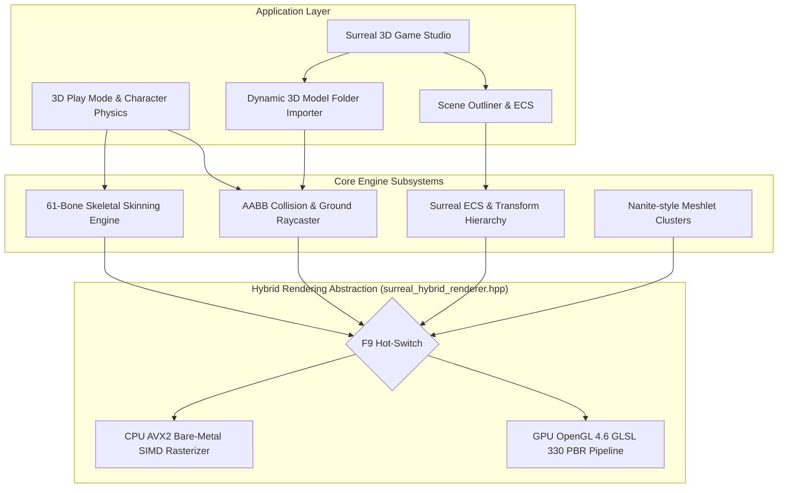

# Surreal 3D Engine & Game Studio
### Sovereign CPU + GPU Hybrid 3D Game Engine & Studio for Linux & CosmOS

[](LICENSE)
[](https://en.cppreference.com/w/cpp/17)
[](https://www.opengl.org/)
[](https://en.wikipedia.org/wiki/Advanced_Vector_Extensions)
[](https://github.com/Herakles5)

**Surreal 3D Engine** is a high-performance, dual-backend 3D game engine and live studio designed for autonomous operating systems (CosmOS) and modern desktop Linux. It features a hot-swappable rendering pipeline (GPU OpenGL 4.6 vs. CPU AVX2 bare-metal software rasterizer), Nanite-inspired cluster meshlet partitioning, real-time Cook-Torrance PBR shading, a 61-joint skeletal skinning engine, an interactive World Editor with Scene Outliner and Transform Inspector, and a dynamic 3D Model Folder Importer supporting Wavefront OBJ and glTF 2.0 assets.

---

## 🌟 Engine Highlights

- **Dual-Backend Hybrid Architecture (`[F9]` Hot-Switch)**:
  - **GPU Hardware Accel**: Modern OpenGL 4.6 Core Profile with GLSL 330 Cook-Torrance shaders (~50 FPS, ~4.3ms PBR pass).
  - **CPU AVX2 Bare-Metal**: SIMD-accelerated software rasterizer with sub-pixel depth buffering for driverless, sovereign CosmOS deployments (~28 FPS).
- **Interactive 3D Game Studio & Live Dojo (`[TAB]`)**:
  - **Play Mode**: 3D third-person character controller, physics jumping (`[SPACE]`), AABB obstacle collision, and spring-arm orbit camera with floor clamping.
  - **World Editor Mode**: Scene Outliner tree, Transform Gizmos (`[IJKL / UO]`), PBR Material Inspector, Scaling (`[+/-]`), Platform Spawning (`[K]`), Entity Duplication (`[Shift+D]`), and Deletion (`[DEL]`).
- **Dynamic 3D Model Folder Importer (`[L]`)**:
  - Automatically scans any target directory (e.g. `assets/models/`, `assets/custom_models/`, `~/Downloads/`) for `.obj`, `.gltf`, and `.glb` files.
  - Shows file names, sizes, and formats in a graphical browser with one-click selection.
  - **Screen-to-Ground Raycasting**: Live ghost mesh follows the mouse cursor, snapping directly onto the terrain or platform surfaces.
  - Left-click or `[ENTER]` drops and anchors the 3D model with full physics collision.
- **Nanite-Style Meshlet Pipeline**:
  - Triangle clusters partitioned into 64-vertex / 128-triangle cache-dense meshlets with AABB bounding spheres and frustum culling.
- **glTF 2.0 & Skeletal Animation**:
  - Real-time 61-bone matrix palette skinning with quaternion SLERP keyframe evaluation.
- **Level Persistence**:
  - Instant level serialization to human-readable JSON (`scene_level.json`) via `[F6]` (Save) and `[F7]` (Load).
- **System-Wide Linux Installation**:
  - Installs to `/usr/local/include/surreal/` and `/usr/local/bin/surreal-editor` with full `pkg-config` integration (`surreal.pc`).

---

## 🏗️ Architecture Overview



---

## 🎮 Controls Reference

### Play Mode (`[TAB]` Switch)
| Key | Action |
|---|---|
| `[W / A / S / D]` | Run / Move Character |
| `[SPACE]` | Jump (Gravity & AABB Platform Collision) |
| `[Q] / [E]` or `[Left / Right]` | Orbit Camera Yaw |
| `[Up / Down]` | Tilt Camera Pitch (Safe Floor-Clamping) |
| `[Z] / [X]` or `[Scroll Wheel]`| Zoom Camera In / Out (1.2m - 6.0m) |
| `[R]` | Reset Camera & Player Position |
| `[P]` | Pause / Resume Skeletal Animation |
| `[B]` | Run 100-Frame PBR Benchmark |
| `[TAB]` | Switch to 3D World Editor Mode |

### 3D World Editor Mode (`[TAB]` Switch)
| Key / Mouse | Action |
|---|---|
| `[L]` | Open **3D Model Folder Importer & Asset Browser** |
| `[1] - [9]` | Select Downloaded Model or Built-in Preset |
| `[Mouse Move]` | Raycast Model onto Ground / Platform Surfaces |
| `[Left Click] / [ENTER]` | Confirm & Drop Model into Scene |
| `[Right Click] / [ESC]` | Cancel Placement Mode |
| `[R]` | Rotate Selected / Placing Entity |
| `[C]` | Cycle Material Albedo Color |
| `[M]` | Cycle Metallic & Roughness |
| `[+ / -]` or `[Wheel]` | Scale Entity Dynamically |
| `[I / K / J / L]` | Move Entity on X/Z Axes |
| `[U / O]` | Raise / Lower Entity on Y Axis |
| `[N] / [P]` | Select Next / Previous Entity in Outliner |
| `[Shift + D]` | Clone / Duplicate Selected Entity |
| `[Shift + K]` | Spawn New Platform Box |
| `[DEL] / [X]` | Delete Selected Entity |
| `[F6] / [F7]` | Save / Load Scene Level JSON (`scene_level.json`) |
| `[F9]` | Toggle GPU OpenGL 4.6 <-> CPU Bare-Metal AVX2 |
| `[F11]` / `[Alt+Enter]` | Toggle **Fullscreen** (viewport, depth buffer & HUD re-allocate live; also follows window resize) |

---

## 🚀 Quick Start & Installation

### Prerequisites (Ubuntu / Debian / CosmOS)
```bash
sudo apt update
sudo apt install -y build-essential libsdl2-dev libgl1-mesa-dev pkg-config
```

### 1. Build & Run Locally
```bash
git clone https://github.com/Herakles5/Surreal-engine-Game-editor.git
cd Surreal-engine-Game-editor

# Build using Makefile
make

# Launch the 3D Game Studio
./surreal-editor
```

### 2. System-Wide Installation
To make the engine accessible to all users and build standalone games with `pkg-config`:
```bash
sudo ./install_surreal.sh
```
This installs:
- Headers: `/usr/local/include/surreal/`
- Binaries: `/usr/local/bin/surreal-editor` & `/usr/local/bin/surreal-bench`
- Pkg-Config: `/usr/local/lib/pkgconfig/surreal.pc`

---

## 🧠 Aion Nexus Link (Evolution Engine ↔ Surreal Studio)

Surreal Studio connects, non-blocking and optional, to the Aion Nexus Evolution Engine IPC server
(`/tmp/aion_nexus.sock`, TCP fallback `127.0.0.1:9099`; override with `AION_NEXUS_SOCK`):

- **Nexus → Studio:** live generation / rule count, current evolution step, autonomous goals and newly learned rules appear in the bottom-left *AION NEXUS* panel.
- **Studio → Nexus:** 1 Hz telemetry (FPS, frame time, entities, mode, backend) and every `[B]` benchmark scorecard. The Evolution Engine logs scorecards to `surreal_benchmarks.jsonl`, tracks records, and queues an optimisation task whenever a run averages below 30 FPS. Aion also speaks the result.
- Offline-safe: without a running Evolution Engine the panel shows `OFFLINE (retrying)`. Disable entirely with `--no-aion`.

Aion's own avatars (13 GLB models + Mia) are linked into the importer by `./install_aion_avatars.sh`.

---

## 📦 Dynamic 3D Model Importer

You can import any 3D model downloaded from the web (Turbosquid, Sketchfab, Blender, etc.):
1. Drop your downloaded `.obj`, `.gltf`, or `.glb` files into `assets/models/` or `assets/custom_models/`.
2. Launch `surreal-editor` and press `[TAB]` to enter Editor Mode.
3. Press `[L]` to open the Model Importer.
4. Click your file in the list or press `[1]–[8]` (items on the current page). Page through large libraries with `[,]` / `[.]` (or `[PgUp]` / `[PgDn]`); `[9]` Ramp, `[0]` Monolith, `[M]` Mia clone are the built-in presets.
5. Move the mouse to position the ghost model on the ground or on top of platforms.
6. Left-click to drop it into the world. It will instantly receive physical collisions!

---

## 💻 Developer API (`pkg-config`)

You can create independent standalone games using Surreal Engine:

```cpp
// game.cpp
#include <surreal/surreal_engine.hpp>
#include <surreal/surreal_camera.hpp>
#include <iostream>

int main() {
    Surreal::SurrealEngine engine(960, 640);
    std::cout << "[✓] Game initialized with Surreal Engine v1.0.0\n";
    return 0;
}
```

Compile with:
```bash
g++ -std=c++17 game.cpp $(pkg-config --cflags --libs surreal) -o my_game
./my_game
```

---

## 📜 License
Distributed under the MIT License. See [LICENSE](LICENSE) for details.
Developed by Herakles5 for CosmOS & Linux Sovereign Gaming Ecosystems.

